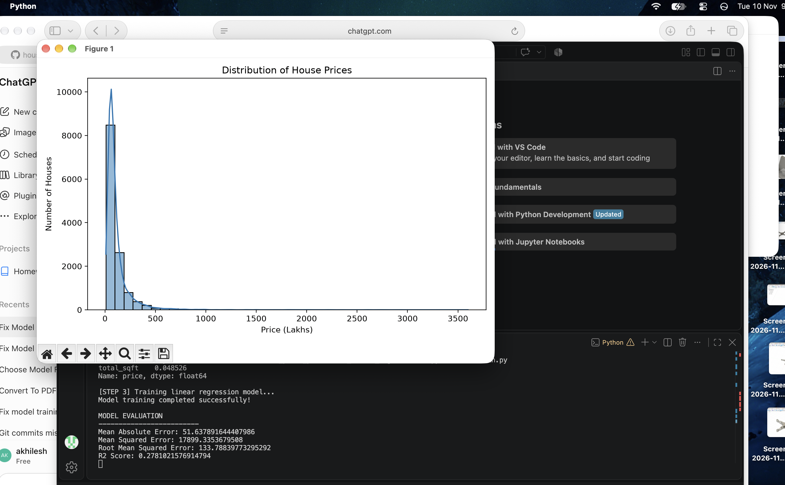

<p align="center">
  
</p>

# **HOUSE_PRICE_PREDICTION_LINEAR_REGRESSION**
<p align="center">


</p>
AI101 Mini project:House Price Prediction using Linear Regression on an Indian housing dataset

# **TEAM MEMBERS AND ROLES**
|Name|Roll Number | Role|
|---|---|---|
|Anandita Chaudhary|2026AIB1011|documentation lead|
|Divesh Singla|2026EEB1346|video lead|
|Aditya Santosh Madane|2026AIB1005|ppt lead|
|Korra Akhil|2026MCB1536|execution lead|

## 🗂️ Project Structure

<p align="center">
  <b>🏡 HOUSE PRICE PREDICTION</b><br/>
  <i>AI Mini-Project | IIT Ropar</i>
</p>

house_price_prediction_linear_regression/
│
├── data/
│   └── bengaluru_house_prices.csv
│
├── src/
│   ├── main.py
│   ├── data_preprocessing.py
│   ├── data_analysis.py
│   ├── model_training.py
│   ├── plots.py
│   └── view_model.py
│
├── outputs/
│   ├── actual_vs_predicted.png
│   ├── area_vs_price.png
│   ├── bhk_vs_price.png
│   ├── correlation_heatmap.png
│   ├── price_distribution.png
│   ├── residual_plot.png
│   ├── expected_output.png
│   ├── predictions.csv
│   └── results.txt
│
├── AI101_House_Price_Prediction_Presentation_FINAL.pptx
├── README.md
├── requirements.txt
└── .gitignore

### 📁 Directory Guide

| Component | Description |
|:--|:--|
| 📂 `data/` | Dataset used for house price prediction |
| 📂 `src/` | Python code for data preprocessing, model training and prediction |
| 📂 `outputs/` | Model evaluation results and prediction visualizations |
| 📂 `presentation/` | Project presentation slides |
| 📂 `video/` | Project demonstration video link |
| 📄 `requirements.txt` | Required Python packages |
| 📄 `README.md` | Project overview, setup and execution instructions |
| 📄 `.gitignore` | Files and folders Git should ignore |

### ⚙️ Project Workflow

**Dataset** → **Data Cleaning** → **Feature Selection** → **Linear Regression** → **Price Prediction** → **Model Evaluation**

---

<p align="center">
  <i>Built with Python • Pandas • NumPy • Scikit-learn</i>
</p>

## How to Run the Project

Follow these steps to download, set up, and run the Bengaluru House Price Prediction project on your computer.

### 1. Clone the Repository

Open Terminal (Linux/macOS) or Command Prompt / PowerShell (Windows) and run:

```bash
git clone https://github.com/anandita2008/house_price_prediction_linear_regression.git
```

### 2. Navigate to the Project Folder

```bash
cd house_price_prediction_linear_regression
```

### 3. Create a Virtual Environment

A virtual environment keeps the project's Python dependencies separate from other projects.

```bash
python3 -m venv venv
```

On Windows, use:

```bash
py -m venv venv
```

### 4. Activate the Virtual Environment

**Linux / macOS:**

```bash
source venv/bin/activate
```

**Windows (Command Prompt):**

```cmd
venv\Scripts\activate.bat
```

**Windows (PowerShell):**

```powershell
.\venv\Scripts\Activate.ps1
```

### 5. Install Required Libraries

Upgrade pip and install all required dependencies:

```bash
python -m pip install --upgrade pip
python -m pip install -r requirements.txt
```

### 6. Check the Dataset

Make sure the Bengaluru house price dataset is available inside the `data` folder.

Expected location:

```text
data/bengaluru_house_prices.csv
```

### 7. Run the Project

Execute the main Python file from the project root directory:

```bash
python3 src/main.py
```

The program will automatically:

1. Load and preprocess the Bengaluru house price dataset.
2. Perform exploratory data analysis (EDA).
3. Generate data visualizations.
4. Train a Linear Regression model.
5. Evaluate model performance using appropriate metrics.
6. Save the trained model and prediction results.

### 8. View the Results

After successful execution, check the `outputs` folder for generated results, such as:

- Data visualization graphs
- Actual vs Predicted price plot
- Residual plot
- Correlation heatmap
- Model evaluation results
- Predictions CSV file
- Trained Linear Regression model (`.pkl`), if generated by the program

### 9. Deactivate the Virtual Environment

After completing the execution, run:

```bash
deactivate
```

**Note:** Python 3 and Git must be installed on your computer. Always execute the commands from the project's root directory.
## Viewing Trained Model Details

The project includes an additional Python script, `view_model.py`, to inspect the saved Linear Regression model.

### How to Open and Run view_model.py

1. Open the project folder in Terminal:

   ```bash
   cd house_price_prediction_linear_regression
   ```

2. Open the `view_model.py` file in the text editor:

   ```bash
   open -e view_model.py
   ```

3. To execute the script, run:

   ```bash
   python3 view_model.py
   ```

4. The script displays:
   - Model type
   - Model coefficients
   - Model intercept
   - Feature names used by the trained model

**Note:** Run `src/main.py` first to generate the trained model file. Then execute `view_model.py` to inspect it.


**Note:** This is an optional utility script. It is not required to run the main project. Run `src/main.py` first to generate the latest trained model.


# output
## Expected Output




## 🤖 AI-Use Disclosure

AI tools were used to support the development and documentation of this mini-project.

- **ChatGPT:** Assisted with project planning, README documentation, understanding Python and machine learning concepts, and debugging suggestions.
- **Human verification:** The team is responsible for reviewing, understanding, testing, and validating the code and project outputs.
- **Dataset and results:** The dataset and model evaluation results are handled separately from AI-generated suggestions. No claim is made that AI generated or verified the results.

**Declaration:** AI tools were used as assistants for learning and development. All team members are responsible for understanding the implementation and explaining the project during evaluation.

